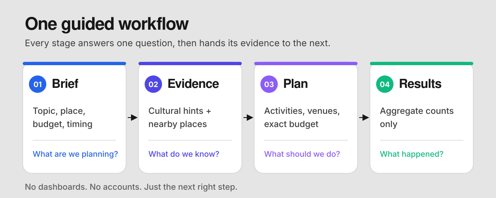
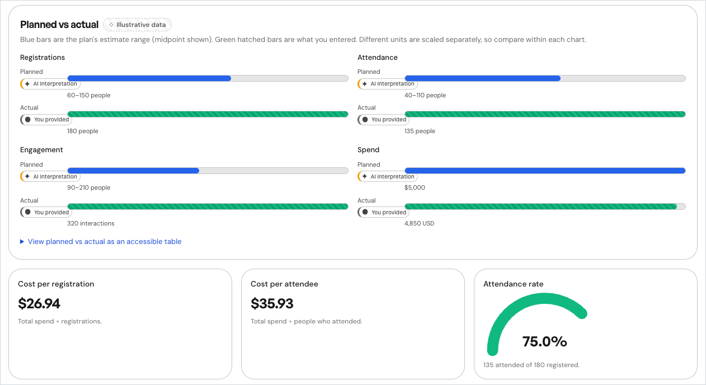
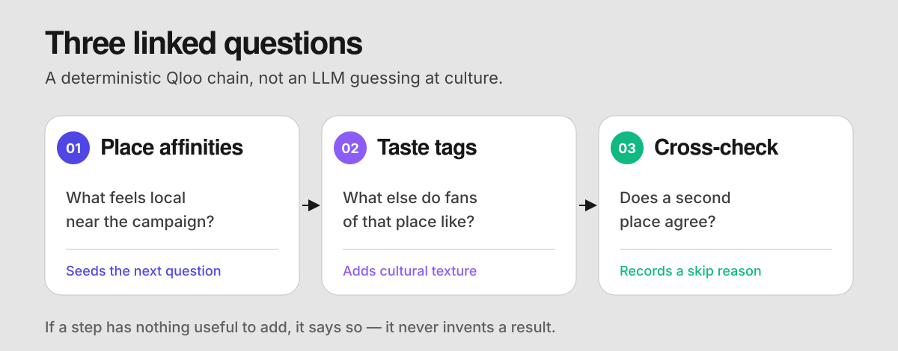
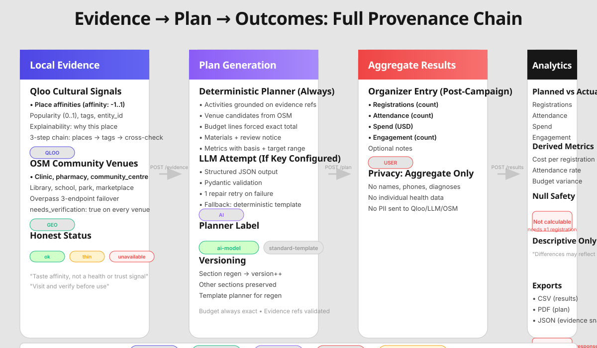
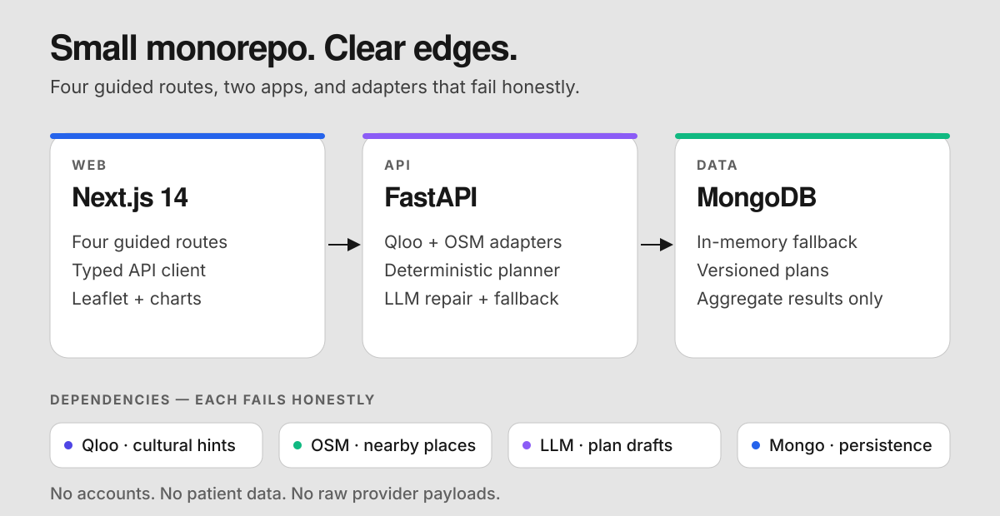

<p align="center">
  
</p>

<p align="center">
  <strong>Plan community health outreach with local taste signals, nearby candidate places, and an inspectable plan — then compare what you planned with what happened.</strong>
</p>

<p align="center">
  <sub>Next.js 14 · FastAPI · TypeScript strict · Python 3.11+ · 45 backend tests · MIT</sub>
</p>

<p align="center">
  <a href="#why-healthreach">Why</a> ·
  <a href="#how-it-works">How it works</a> ·
  <a href="#a-look-inside">Look inside</a> ·
  <a href="#architecture">Architecture</a> ·
  <a href="#quick-start">Quick start</a> ·
  <a href="#demo">Demo</a> ·
  <a href="#documentation">Docs</a> ·
  <a href="#limitations">Limitations</a>
</p>

---

## Why HealthReach

Community health teams plan screening camps, vaccination drives, and awareness events with tight budgets and little local evidence. A generic poster, a venue nobody can reach, or a message that sounds like a lecture can quietly waste the whole campaign.

HealthReach gathers two honest inputs, then turns them into a plan you can inspect:

- **Qloo taste signals** — tone and themes that feel familiar nearby. Not health need, trust, footfall, or diagnosis.
- **OpenStreetMap places** — candidate venues worth a visit. Not capacity, permission, or guaranteed attendance.

Every screen answers four questions in plain language: what this is, why it matters, what to do next, and where the number came from. No black box, no promises, no patient records.

---

## How it works

<p align="center">
  
</p>

One campaign, four staged sections. No dashboard, no account, no settings.

1. **Brief** — describe the topic, place, audience, budget, and timing. Type a location or pick it on the map.
2. **Evidence** — review Qloo hints and candidate places. Each row shows its source and an honest `ok`, `thin`, or `unavailable` status.
3. **Plan** — inspect activities, venues, the exact budget, draft materials, and estimate ranges. Regenerate a single section without losing the rest.
4. **Results** — enter aggregate counts only. Compare planned with actual through descriptive charts and an accessible table.

> Failure stays visible. Missing keys become clear setup states, thin evidence stays thin, and the plan says `standard-template` whenever an AI model did not run.

---

## A look inside

<p align="center">
  
  <br>
  <sub>Planned vs actual: planned estimate ranges, organizer-entered actuals, and descriptive cost metrics. Demo campaign shown with illustrative data.</sub>
</p>

The workspace keeps the reasoning next to the plan. Evidence snapshots are stored, plan versions are comparable, and exports contain aggregate counts only — no names, contact details, diagnoses, API keys, or raw provider responses.

---

## Local evidence, not local guesses

<p align="center">
  
</p>

Qloo runs as a deterministic three-step backend chain, not an LLM tool:

1. **Place affinities** near the campaign area.
2. **Taste tags** seeded by the top place's entity ID.
3. **Cross-check** the same question about a second place.

Every step is persisted with its own provenance and a plain-language reason. Skipped steps are recorded, never invented. Qloo supplies taste affinity only: it is not used for venues, footfall, health need, trust, or epidemiology.

---

## Every fact keeps its source

<p align="center">
  
</p>

Provenance is part of the data, not a tooltip. Every displayed value carries an icon, text label, and border treatment:

- **Qloo** — taste affinity; never a medical fact
- **Geo** — an OpenStreetMap candidate place; needs a visit
- **AI** — an estimate or draft; inspect and approve it
- **User** — organizer input or actual result
- **Illustrative** — demo value only

Estimate ranges state their basis, analytics stay descriptive rather than causal, and the planner label tells you whether a model or the deterministic template built the plan. Cultural relevance is not community trust; every venue still needs an in-person visit and permission check.

---

## Architecture

<p align="center">
  
</p>

A Turborepo with two apps and two shared packages:

- `apps/web` — Next.js 14 App Router, React 18, TypeScript strict, Tailwind CSS, Leaflet
- `apps/api` — FastAPI, Pydantic v2, Motor for MongoDB, plus an in-memory fallback
- `packages/ui` — design tokens and provenance metadata
- `packages/tsconfig` — shared strict TypeScript base

Integrations live behind adapters that own their timeouts, retries, and error mapping:

- **Qloo** — cultural affinity hints. If missing: `unavailable` state, plan flagged, retry only when meaningful.
- **Nominatim + Overpass** — geocoding and candidate places. If missing: honest unavailable state; the typed location remains the source of truth.
- **LLM** — drafting the outreach plan. If missing: schema-validated attempt, one repair retry, then the deterministic template with an exact budget.
- **MongoDB** — persistence. If missing: transparent in-memory fallback; data is lost on restart.

Charts, venue clustering, and PDF export are intentionally dependency-free.

---

## Quick start

**Prerequisites:** Node 18+, pnpm 9+, Python 3.11+. MongoDB is optional.

```bash
git clone https://github.com/thenameisomm/HealthReach.git
cd HealthReach
python3 -m venv .venv
source .venv/bin/activate
python -m pip install -e "apps/api[test]"
cp .env.example .env   # fill only the keys you have; empty keys degrade gracefully
pnpm install
pnpm dev               # web on :3000, API on :8000
```

Open **http://localhost:3000**. No keys? Choose the **East Austin, TX** demo (USD) or the **Kothrud, Pune** demo (₹). Both run the full flow on labeled illustrative data.

### Commands

| Task             | Command                                   |
| ---------------- | ----------------------------------------- |
| Web only         | `pnpm dev:web`                            |
| API only         | `pnpm dev:api`                            |
| Build            | `pnpm build`                              |
| Lint / typecheck | `pnpm lint`, `pnpm typecheck`             |
| Backend tests    | `pnpm --filter @healthreach/api test`     |
| API type parity  | `pnpm generate:api` (API must be running) |
| Optional MongoDB | `docker run -d -p 27017:27017 mongo:7`    |

`pnpm dev:api` runs `uvicorn app.main:app --reload` from `apps/api`.

<details>
<summary><strong>Environment variables</strong> — all secrets stay server-side</summary>

- `QLOO_API_KEY` — API. Empty: cultural hints show `unavailable`; the plan is flagged.
- `LLM_API_KEY` (+ `LLM_BASE_URL`, `LLM_MODEL`) — API. Empty: deterministic template planner, same schema, exact budget.
- `MONGODB_URI` — API. Empty: in-memory store; data is lost on restart.
- `CORS_ORIGINS` — API. Empty: defaults to `http://localhost:3000`.
- `NEXT_PUBLIC_API_URL` — Web. Empty: defaults to `http://localhost:8000`; public, not a secret.

See the committed [`.env.example`](.env.example). Nothing prefixed `NEXT_PUBLIC_` is secret.

</details>

---

## Demo

- **East Austin, TX (default)** — diabetes screening camp, ages 30–65, 7 days · $5,000 · USD, miles
- **Kothrud, Pune** — diabetes screening camp, ages 30–60, 7 days · ₹10,000 · INR

Both demos require no keys and run the full flow behind a persistent dashed “Illustrative data” banner. Every demo value is tagged `provenance: illustrative` in API responses. Real-mode code never imports demo data.

---

## What works today

| Area         | Implemented                                                                                                                         |
| ------------ | ----------------------------------------------------------------------------------------------------------------------------------- |
| **Planning** | Four guided routes, autocomplete and map-picked locations, exact-budget planner, section regeneration, plan version comparison      |
| **Evidence** | Qloo three-step chain, OSM candidates, provenance chips, honest statuses, backend-observed progress counter                         |
| **Results**  | Aggregate entry, descriptive planned-vs-actual analytics, accessible charts, map clustering with a venue list, CSV/JSON/PDF exports |
| **Trust**    | Isolated demo data, privacy-safe exports, qualified-professional review notices, plain-language error and fallback states           |

**Verification:** 45 backend tests pass; `pnpm lint`, `pnpm typecheck`, and `pnpm build` are clean. Browser QA covers both demos at 1280×900 and 390×844, including maps, charts, exports, progress, and mobile overflow.

```bash
pnpm lint
pnpm typecheck
pnpm build
pnpm --filter @healthreach/api test
```

---

## Documentation

- **Product:** [Brief](docs/product/PRODUCT_BRIEF.md) · [Problem and users](docs/product/PROBLEM_AND_USERS.md) · [Scope and non-goals](docs/product/SCOPE_AND_NON_GOALS.md) · [User flows](docs/product/USER_FLOWS.md) · [Roadmap](docs/product/ROADMAP.md)
- **Architecture:** [System overview](docs/architecture/SYSTEM_OVERVIEW.md) · [Data flow](docs/architecture/DATA_FLOW.md) · [Agent orchestration](docs/architecture/AGENT_ORCHESTRATION.md) · [Error handling](docs/architecture/ERROR_HANDLING.md) · [Security and privacy](docs/architecture/SECURITY_AND_PRIVACY.md)
- **Integrations:** [Qloo chain](docs/integrations/QLOO_AGENT_CHAIN.md) · [LLM contract](docs/integrations/LLM_CONTRACT.md) · [OSM](docs/integrations/OSM_INTEGRATION.md) · [Geocoding](docs/integrations/GEOCODING_AND_LOCATION.md)
- **Data and API:** [Data model](docs/data/DATA_MODEL.md) · [Provenance](docs/data/PROVENANCE_MODEL.md) · [Estimates](docs/data/ESTIMATES_AND_METRICS.md) · [API contracts](docs/api/API_CONTRACTS.md) · [Error responses](docs/api/ERROR_RESPONSES.md)
- **Frontend:** [Architecture](docs/frontend/FRONTEND_ARCHITECTURE.md) · [Routes and workspace](docs/frontend/ROUTES_AND_WORKSPACE.md) · [Design system](docs/frontend/DESIGN_SYSTEM.md) · [Accessibility](docs/frontend/ACCESSIBILITY.md) · [Visualization](docs/frontend/VISUALIZATION_GUIDELINES.md)
- **Quality and operations:** [Test strategy](docs/quality/TEST_STRATEGY.md) · [Manual QA](docs/quality/MANUAL_QA.md) · [Getting started](docs/operations/GETTING_STARTED.md) · [Configuration](docs/operations/CONFIGURATION.md) · [Runbook](docs/operations/RUNBOOK.md) · [Troubleshooting](docs/operations/TROUBLESHOOTING.md)
- **Project history:** [Decisions log](docs/project/DECISIONS_LOG.md) · [Changelog](docs/project/CHANGELOG.md) · [Risks](docs/project/RISKS_AND_MITIGATIONS.md)

The full index lives in [`docs/`](docs/README.md).

---

## Limitations

- Qloo coverage is uneven outside major metros; thin responses are shown as thin.
- OSM venue completeness varies; every place needs on-ground verification.
- No footfall, health-need, trust, or outcome data is used.
- LLM plans must cite evidence IDs; malformed output gets one repair retry, then falls back.
- No Hindi or Marathi localization yet, and no offline mode beyond honest error states.
- The results map has no reach-estimate overlay because there is no venue-capacity data. Its optional 1-mile circle is a search area, not attendance.
- Charts, clustering, and PDF export cover the documented flows but are not a general charting or PDF toolkit.

---

## License

MIT — see [`LICENSE`](LICENSE).

## Contributing

Read [`AGENTS.md`](AGENTS.md) for the contributor contract: commands, coding conventions, honesty rules, and verification requirements. Issues and pull requests are welcome.

---

<p align="center">
  <sub>Cultural signals by Qloo — taste affinity only, never diagnosis or health need. Place data © OpenStreetMap contributors (ODbL). No patient data is collected.</sub>
</p>
